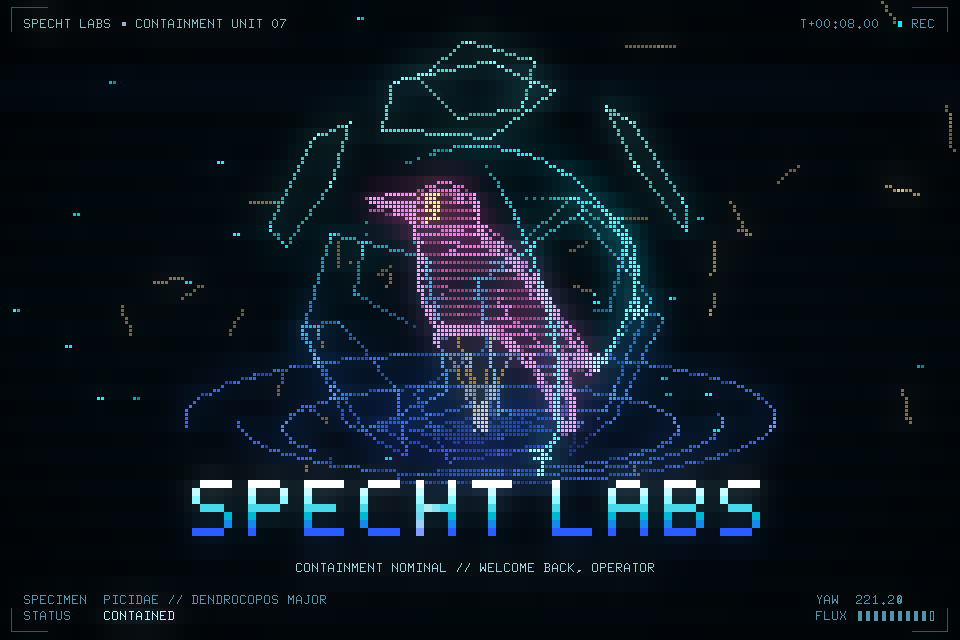

# gibson

A retro neon intro for your terminal: a hologram specimen in a containment
vessel, wireframes, bloom, a decrypting title and a boot log. Mostly Tron and
Hackers (1995), with a bit of synthwave, Kung Fury's Hackerman and Umbrella
Corp. It's rendered in braille sub-pixels with 24-bit color, and it runs
locally or as an SSH app anyone can connect to.



```sh
ssh -p 2222 gibson.example.com                 # whatever the server is set up for
ssh -t -p 2222 gibson.example.com dodeca specht   # pick the look per session
```

Any key quits, and `r` restarts the sequence.

## Run it

```sh
mise install                  # the pinned Go toolchain and tools
mise run gibson               # play the intro in this terminal
mise run serve                # serve it over SSH on :2222, then: ssh -p 2222 localhost
```

Or install a release: `brew install --cask spechtlabs/tap/gibson`, or download an
archive from the [releases](https://github.com/SpechtLabs/gibson/releases).

| Look       | Values                                  |
|------------|-----------------------------------------|
| `theme`    | `synth` (default), `specht`, `umbrella` |
| `vessel`   | `hex` (default), `dodeca`               |
| `specimen` | `bird` (default), `blob`                |

Over SSH, any of these words after the host overrides the server's look for
that session. Pass `-t`, since ssh only allocates a terminal for a command
when asked to.

## Configuration

Every flag can also be set in a config file or through the environment. A flag
beats an environment variable, which beats the config file, which beats the
default.

- **Config file:** `--config <path>`, or `gibson.yaml` found in `.`,
  `~/.config/gibson/` or `/etc/gibson/`. [`gibson.example.yaml`](gibson.example.yaml)
  documents every key.
- **Environment:** `GIBSON_` followed by the key, with `.` and `-` written as
  `_`. For example, `ssh.max-sessions` is `GIBSON_SSH_MAX_SESSIONS`.

```text
gibson                 play the intro locally
gibson serve           serve it over SSH
gibson render          write a PNG frame or a GIF of the sequence
gibson healthcheck     exit 0 if the SSH server answers (container health check)
```

## Container image

`ghcr.io/spechtlabs/gibson` is a multi-arch image (`linux/amd64`, `linux/arm64`)
published with every release. It's tagged `latest`, `X.Y.Z` and `vX.Y`.

```sh
docker run -d --name gibson -p 2222:2222 \
  --read-only --cap-drop ALL --security-opt no-new-privileges \
  -v gibson-data:/data ghcr.io/spechtlabs/gibson:latest
```

[`deploy/compose.yaml`](deploy/compose.yaml) is the same with resource limits.
The image is hardened:

- **Base:** [distroless static](https://github.com/GoogleContainerTools/distroless),
  pinned by digest. It has no shell, no package manager and no libc, only the
  static binary.
- **Runtime:** it runs as uid 65532 and needs no capabilities. It works with a
  read-only root filesystem, and the only writable path is the `/data` volume,
  where the SSH host key is generated on first start.
- **Health check:** `HEALTHCHECK` runs `gibson healthcheck`, which checks for an
  SSH banner.
- **Supply chain:** every image has an SBOM and max-mode build provenance
  attached. It's signed keylessly with cosign, scanned with Trivy on release and
  weekly afterwards, and the findings go to GitHub code scanning.

To verify an image:

```sh
cosign verify ghcr.io/spechtlabs/gibson:latest \
  --certificate-oidc-issuer https://token.actions.githubusercontent.com \
  --certificate-identity-regexp '^https://github\.com/SpechtLabs/gibson/\.github/workflows/release\.yaml@'
```

### Server limits

The server has no authentication, since it's a demo anyone may watch. But
every viewer costs a full render per frame, so the server is bounded
everywhere:

| Key                | Default | Limits                                          |
|--------------------|---------|-------------------------------------------------|
| `ssh.max-conns`    | 128     | open connections, unfinished handshakes included |
| `ssh.max-sessions` | 32      | concurrent sessions (one connection can open several) |
| `ssh.rate`         | 0.5     | new sessions per second per IP...               |
| `ssh.burst`        | 5       | ...with this burst on top                       |
| `ssh.max-duration` | 15m     | lifetime of a connection                        |

Handshakes time out after 10s, and terminal sizes are capped at 400×150.
Bandwidth is about 0.5 MB/s per viewer at 30 fps in a 120×40 terminal, so
`fps: 20` is kinder over the internet.

## Development

`mise run check` runs what CI runs: golangci-lint with
[golint-sl](https://golint.specht-labs.de/), yamllint, actionlint, zizmor,
hadolint, a tidy check and the GoReleaser config check. `mise run image` builds
the images locally from a GoReleaser snapshot, and `mise run tasks` lists the
rest.

### Releases and maintenance

- **Releases:** [release-please](https://github.com/googleapis/release-please)
  reads the Conventional Commit titles on `main` and keeps a release pull
  request open. Merging it tags the release, and GoReleaser then publishes the
  archives, the Homebrew cask and the signed image.
- **Dependencies:** [Renovate](renovate.json) keeps everything current: Go
  modules, the toolchain, the distroless digest, mise tools and pinned Action
  SHAs. It automerges patch and minor updates once CI passes. Anything that
  ends up in the binary or the image lands as `fix(deps)`, which cuts a release,
  so the published image picks the fix up. Tooling lands as `chore(deps)` and
  releases nothing.

## License

[Apache 2.0](LICENSE)
